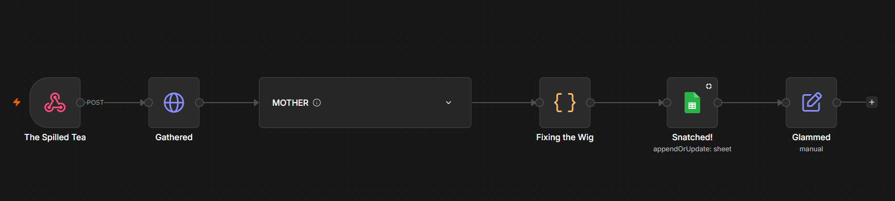
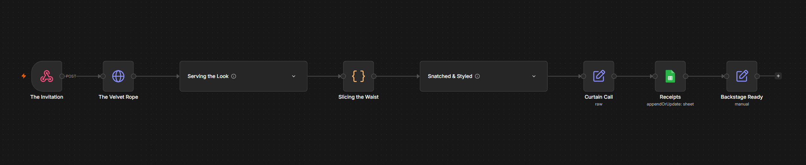

## Hi, I'm Tye 👋

**Technical Program Manager** · Tacoma, WA

I build the operating rhythms that let cross-functional teams ship. 14+ years turning ambiguous stakeholder needs into executable plans - including 7 years
driving global launches and tentpole campaigns for Xbox.

- 🔭 Currently a Project Manager for Xbox Digital Marketing, and open to what's next

- ⚙️ I automate the repetitive parts of program work: n8n workflows, custom tooling, AI-assisted delivery

- 💬 Ask me about launch readiness, dependency mapping, or timezone math across 45 markets

📫 [LinkedIn](YOUR-LINKEDIN-URL) · [Portfolio](https://www.tyejohnson.dev/)

### 🛠️ What I'm building

**Rejection Quest HQ** - a Lovable command center wired to two n8n webhooks: one that
scores and triages inbound listings on a 0-100 match scale, one that generates tailored
documents on approval. The app is the source of truth - a Google Sheet keeps an
append-only audit log, written only by the webhooks below. Listings land as Pending by
default; archive and portal auto-detection are built in.

**The Assistant** (n8n webhook) - takes any listing URL, extracts the full posting
content (even from JavaScript-heavy pages), and scores it across six weighted categories
with hard gates on salary floor and location. Unreadable input scores a 0, never a
hallucination.

**The Tailor** (n8n webhook) - on approval only, generates tailored documents from a
source profile under a strict fact-lock: rephrase what's true, never invent. Finished
docs land as editable Google Docs; links go back to the log.

**Human-in-the-loop, always** - nothing is generated or sent without explicit approval.
The machines do the paperwork; I make the decisions.
